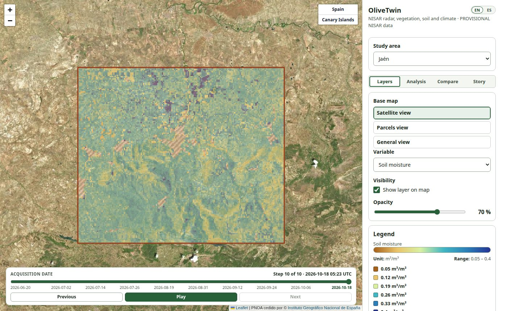
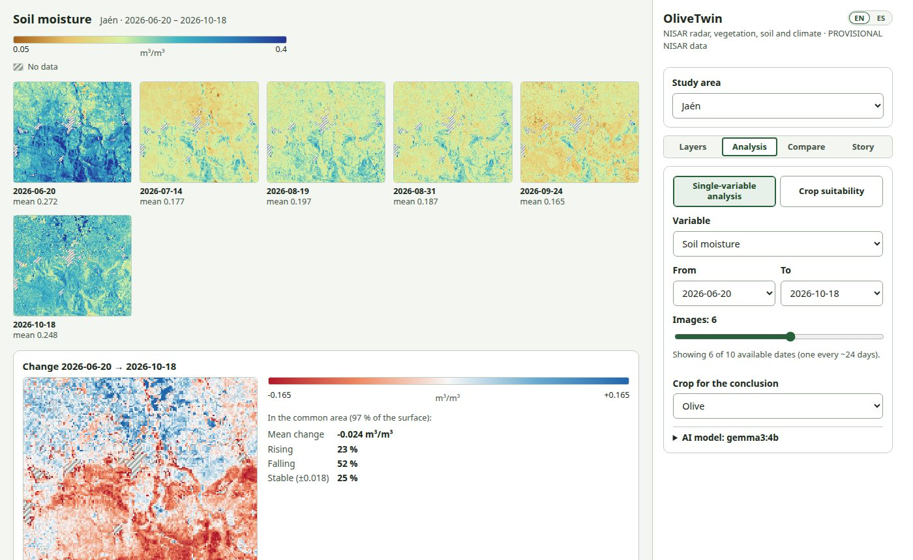
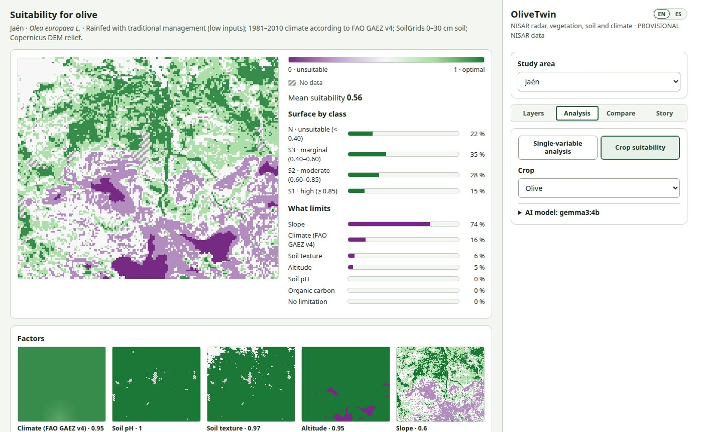
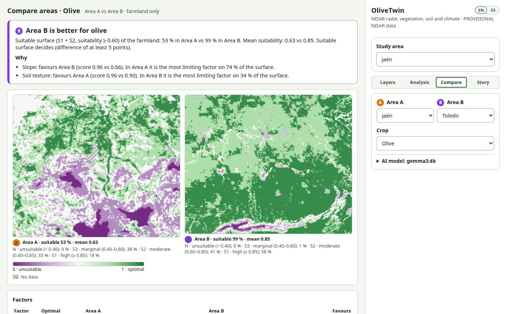

# OliveTwin

**Radar, vegetation, soil and climate data turned into crop-suitability maps for Mediterranean agriculture.**

[](https://alros14.github.io/olivetwin/)
[](https://github.com/AlRos14/olivetwin/actions/workflows/ci.yml)
[](LICENSE)
[](https://www.spaceappschallenge.org/2026/challenges/dancing-with-the-sars/)

### ▶ [Open the live demo](https://alros14.github.io/olivetwin/)

It runs in the browser: nothing to install, no account needed. The interface is in English, with Spanish available from the
language switch.



## What OliveTwin does

Farmers, cooperatives and agronomists need to know how the soil behaves through the season and which land suits each crop.
OliveTwin combines radar soil moisture from the **[NISAR](https://nisar.jpl.nasa.gov/)** mission (NASA-ISRO) with optical
vegetation indices, terrain, soil properties and climate. It shows how the land changes over time and estimates where
olive, almond and rainfed wheat fit best.

Radar is the core of the idea. It observes day and night, through clouds, and its signal is sensitive to the water in the
soil, so the drying and recharge of the soil can be followed through a whole season.

The current release covers two olive-growing areas in Spain, **Jaén** and **Toledo**, from June to October 2026, on a grid of
about 200 m.

## Features

| Tab | What it is for |
|---|---|
| **Layers** | Show any variable on the map (soil moisture, radar, vegetation, terrain, soil, climate, land cover) with its timeline, legend and an explanation of why it matters for the crop. Base maps: satellite, agricultural parcels (SIGPAC) or general map. |
| **Analysis** | Study one variable: images by date, change map, charts and values. Pick a crop to see its **reference values** (optimal, acceptable, unsuitable) and its **crop suitability**: a suitability map, which factor limits it and where. |
| **Compare** | Choose **Area A**, **Area B** and a crop to see which area is better, and why. |
| **Story** | Why radar, and hypotheses the app lets you explore. |

| Analysis | Crop suitability | Compare |
|---|---|---|
|  |  |  |

In Analysis and Compare, **Interpret with AI** asks a language model to explain the results in plain words. It is optional,
see [below](#ai-interpretation-optional).

> ⚠️ **Provisional data.** NISAR SME2 soil moisture is not yet fully calibrated. It measures only the top ~5 cm of the soil
> and **is not an irrigation requirement**. Crop suitability is a physical land model, not a yield forecast.

## Where it can go next

OliveTwin is meant to grow beyond the two pilot areas. The pipelines work from an area's bounding box and the web app is
static, so it is cheap to host and extend. Possible next steps:

- **More areas and crops**: run the pipelines on new regions and add crops from the FAO and university tables already used.
- **Longer time series**: update the data as new NISAR passes and calibrated product versions are released.
- **Field validation**: compare soil moisture with in-situ sensors and suitability with real yields, together with growers
  and research groups.
- **Decision support**: once the products are calibrated and validated, combine moisture, weather and crop needs into
  guidance for water management.

Contributions and partnerships are welcome: see [Contributing](#contributing).

## Data

All inputs are open or free for research use.

| Group | Variables | Source |
|---|---|---|
| NISAR radar | Soil moisture (SME2), HH, HV and HV/HH backscatter (GCOV), coherence (GUNW) | NASA/JPL–ISRO, via ASF DAAC |
| Reference soil moisture | SMAP soil moisture | NASA, via NSIDC DAAC |
| Vegetation | NDVI and NDMI | Copernicus Sentinel-2 |
| Terrain | Elevation and slope | Copernicus DEM |
| Soil | Clay, sand, organic carbon and pH | ISRIC SoilGrids 2.0 |
| Climate | Rainfall, temperature, ET0 (daily) and 1991–2020 climate normals | Open-Meteo (ERA5) |
| Land cover | Agricultural land and olive groves | CORINE Land Cover 2018 |
| Crop suitability | Olive, almond and rainfed wheat | Own model using FAO GAEZ v4, FAO ECOCROP and University of Granada tables |

Quantities use SI units (or units accepted for use with the SI) and dates are ISO 8601 in UTC. The full list of sources,
licences and attributions is in [`docs/data-sources.md`](docs/data-sources.md); the required attributions are in
[`NOTICE`](NOTICE).

### How suitability is computed

Each factor (climate, pH, texture, slope, organic carbon and elevation) is scored from 0 to 1 against the published
requirements of the crop, and suitability is the **worst** of the factors. Classes: S1 (high, ≥ 0.85), S2 (moderate),
S3 (marginal) and N (unsuitable, < 0.40). **Compare** only counts agricultural land, and the area with more suitable land
(S1 + S2) wins. Details and decisions: [`pipelines/analysis/README.md`](pipelines/analysis/README.md).

## Limitations

- **Provisional NISAR products.** Use them for relative changes, with care. Jaén is observed at dawn (~05:23 UTC) and Toledo
  at dusk (~19:09 UTC).
- **Gaps without data.** NISAR does not estimate moisture over urban areas, water or dense vegetation, and from mid-August
  the Toledo pass covers ~80 % of the area. Gaps are hatched in grey; calculations use only the common area with data.
- **Suitability is physical, not a yield model.** It does not account for plant-available water, alternate bearing,
  management or profitability, and it has not been validated against yields. Each area is the chosen box, not its province.
- **The AI is only a guide.** It summarises the statistics it receives and can be wrong, especially with small models.
- **Network required** for the base maps. SIGPAC parcels only appear when zoomed in (zoom 15 or more).

## Run it locally

You need **Node.js 22** (version in [`.nvmrc`](.nvmrc)), npm and an Internet connection for the base maps. It is a static
site: no server or database, and the data are already in the repository.

```bash
git clone https://github.com/AlRos14/olivetwin.git
cd olivetwin/frontend
npm ci
npm run dev
```

Open **<http://localhost:5173/>**. If `npm ci` fails, check your Node.js version (`node --version`; with nvm, `nvm use`).

### AI interpretation (optional)

The app works without AI. To enable it with a free local model, install [Ollama](https://ollama.com) and run:

```bash
OLLAMA_ORIGINS="http://127.0.0.1:*,http://localhost:*,https://alros14.github.io" ollama serve
ollama pull gemma3:4b
```

Then press **Interpret with AI**, locally or on the live demo (the browser may ask for permission to access the local
network). Under **AI model** you can switch to any OpenAI-compatible service, for example a cloud one with your own key; the
key is kept only for the browser session. On a computer without a GPU, each interpretation takes a few minutes.

## Contributing

| Part | Technology | Documentation |
|---|---|---|
| Web app (`frontend/`) | Vue 3, Vite, TypeScript and Leaflet; static site, English and Spanish | [`frontend/README.md`](frontend/README.md) |
| Analysis pipeline (`pipelines/analysis/`) | Python 3.12: downloads and processes every variable | [`pipelines/analysis/README.md`](pipelines/analysis/README.md) |
| NISAR converter (`pipelines/nisar/`) | Python 3.12: SME2 (HDF5) to georeferenced PNG | [`pipelines/nisar/README.md`](pipelines/nisar/README.md) |
| Data contract (`contracts/`) | JSON Schema that validates the published data | [`docs/data-contract.md`](docs/data-contract.md) |

Every pull request runs the `ci` check (data validation, web and pipeline tests, build), and every merge to `main` publishes
the demo on GitHub Pages. Regenerating the data needs a free [NASA Earthdata](https://urs.earthdata.nasa.gov/) account; the
commands are in [`pipelines/analysis/README.md`](pipelines/analysis/README.md), and publishing a new area is described in
[`docs/handoff-science.md`](docs/handoff-science.md). Workflow and conventions: [`docs/contributing.md`](docs/contributing.md).

## Origin and credits

OliveTwin started at the **[NASA Space Apps Challenge 2026](https://www.spaceappschallenge.org/)**, NASA's international
hackathon, as an answer to the challenge
**[Dancing with the SARs](https://www.spaceappschallenge.org/2026/challenges/dancing-with-the-sars/)**: build an
interactive application that uses NISAR radar data to track changes on the Earth's surface. The challenge summary is in
[`docs/challenge.md`](docs/challenge.md).

We thank:

- **NASA** and the **NASA Space Apps Challenge** organisers.
- The **[NISAR](https://nisar.jpl.nasa.gov/)** mission, by NASA and ISRO (Indian Space Research Organisation), with products
  distributed by the **[ASF DAAC](https://asf.alaska.edu/)** (Alaska Satellite Facility).
- **NASA Earthdata** and the **NSIDC DAAC** (SMAP soil moisture).
- **Copernicus** (European Union and ESA): Sentinel-2, Copernicus DEM and CORINE Land Cover; **ISRIC** (SoilGrids),
  **Open-Meteo** (ERA5), **FAO** (GAEZ and ECOCROP), the **University of Granada**, **IGN** (PNOA), **FEGA** (SIGPAC) and
  **OpenStreetMap**.

The team is listed under the repository's [contributors](https://github.com/AlRos14/olivetwin/graphs/contributors).

> NASA does not endorse this project. OliveTwin is an independent work, and the use of NASA data does not imply endorsement.

## License and citation

OliveTwin's code is licensed under **[Apache-2.0](LICENSE)**: you may use, modify and redistribute it with attribution
(keep the [`NOTICE`](NOTICE) file). The data keep the licences of their sources, and some (FAO ECOCROP and FAO GAEZ) allow
**non-commercial** use only; see [`docs/data-sources.md`](docs/data-sources.md).

If you use OliveTwin in research or a presentation, please cite it with [`CITATION.cff`](CITATION.cff) ("Cite this
repository" on GitHub).
