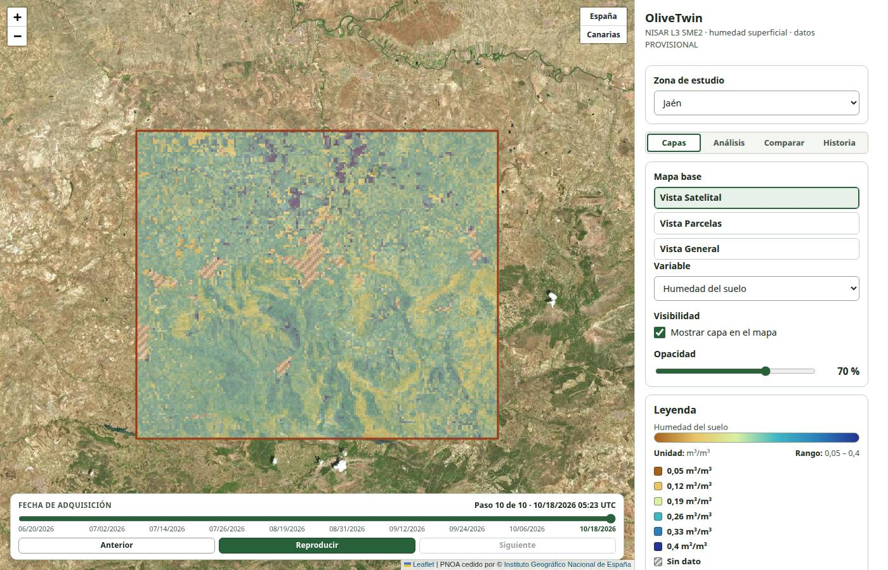

# OliveTwin

**Radar NISAR, vegetación, suelo y clima para saber qué zonas son mejores para el olivo, el almendro y el trigo.**

[](https://www.spaceappschallenge.org/2026/challenges/dancing-with-the-sars/)
[](LICENSE)



## El reto

OliveTwin es nuestra respuesta al reto **«[Dancing with the SARs](https://www.spaceappschallenge.org/2026/challenges/dancing-with-the-sars/)»**
del **NASA Space Apps Challenge 2026**: crear una aplicación interactiva que use
datos radar de la misión **NISAR** (NASA-ISRO Synthetic Aperture Radar) para
seguir y visualizar cambios en la superficie terrestre.

Nuestro cambio es la **humedad del suelo en zonas agrícolas**: cómo se seca y se
recarga el suelo durante el verano de 2026 en dos zonas olivareras de España
(Jaén y Toledo), puesta en contexto con vegetación, relieve, suelo y clima para
estimar qué zonas son más aptas para cada cultivo. El enunciado completo, los
recursos oficiales y la política de licencias están en
[`docs/challenge.md`](docs/challenge.md).

## Qué puedes hacer

| Pestaña | Para qué sirve |
|---|---|
| **Capas** | Ver en el mapa cualquier variable (humedad del suelo, radar, vegetación, relieve, suelo, clima, usos del suelo) con su línea temporal, leyenda y una explicación de para qué sirve en el cultivo. Mapa base: satélite, parcelas agrícolas (SIGPAC) o callejero. |
| **Análisis** | Estudiar una variable: imágenes por fecha, mapa de cambio, gráficas y valores. Al elegir un cultivo, ver sus **valores de referencia** (óptimo, aceptable, no apto). También, **aptitud por cultivo**: mapa de aptitud, qué factor limita y dónde. |
| **Comparar** | Elegir **zona A**, **zona B** y un cultivo para saber cuál es mejor y por qué. |
| **Historia** | El reto, por qué usamos radar e hipótesis que la app permite explorar. |

En Análisis y Comparar, **Interpretar con IA** pide a un modelo de lenguaje que
explique los resultados (opcional, ver más abajo).

> ⚠️ **Datos provisionales.** La humedad NISAR SME2 todavía no está totalmente
> calibrada, mide solo los ~5 cm superficiales del suelo y **no equivale a una
> necesidad de riego**. La aptitud por cultivo es un modelo físico, no una
> predicción de cosecha.

## Ponerlo en marcha

### Requisitos

- **Node.js 22** (la versión está en [`.nvmrc`](.nvmrc)) y npm.
- **Git** para clonar el repositorio.
- **Conexión a Internet**, para cargar los mapas base.
- *(Opcional)* **[Ollama](https://ollama.com)** para la interpretación con IA.

No hace falta servidor ni base de datos: es una web estática y los datos ya
vienen preparados en el repositorio.

### Paso a paso

```bash
# 1. Descarga el proyecto
git clone https://github.com/AlRos14/olivetwin.git
cd olivetwin

# 2. Instala las dependencias de la web
cd frontend
npm ci

# 3. Arráncala
npm run dev
```

Abre **<http://localhost:5173/>**. La zona de Jaén se selecciona sola; cambia
de zona arriba a la derecha y prueba las pestañas.

### Interpretación con IA (opcional)

La app funciona sin IA. Para activarla con un modelo local y gratuito:

```bash
# Instala Ollama (https://ollama.com) y, en otra terminal:
OLLAMA_ORIGINS="http://127.0.0.1:*,http://localhost:*" ollama serve
ollama pull gemma3:4b
```

Después, en la app, pulsa **Interpretar con IA**. En «Modelo de IA» puedes
cambiar a cualquier otro servicio compatible con la API de OpenAI (por ejemplo,
uno en la nube con tu clave). La clave solo se guarda durante la sesión del
navegador. En un ordenador sin GPU, cada interpretación tarda unos minutos.

### Problemas frecuentes

| Problema | Solución |
|---|---|
| `npm ci` falla | Comprueba que usas Node.js 22 (`node --version`; con nvm, `nvm use`). |
| El mapa base sale gris | No hay conexión o el servicio del mapa no responde: cambia de mapa base en Capas. |
| «Interpretar con IA» da error de conexión | Comprueba que `ollama serve` está en marcha con `OLLAMA_ORIGINS` y que descargaste el modelo. Usa «Probar conexión» en «Modelo de IA». |
| La IA tarda mucho | Es normal en CPU con un modelo de 4B; usa un modelo más pequeño o un servicio en la nube. |

### Versión de producción

```bash
cd frontend
npm run build      # genera frontend/dist/
npm run preview    # la sirve en http://localhost:4173/
```

Para publicarla en una subruta (por ejemplo, GitHub Pages):
`npm run build -- --base /olivetwin/`.

## Los datos

Todo procede de fuentes abiertas o de uso libre para investigación. La lista
completa de datos, fuentes, licencias y atribuciones está en
**[`docs/data-sources.md`](docs/data-sources.md)** (las atribuciones obligatorias,
en [`NOTICE`](NOTICE)).

| Grupo | Variables | Fuente |
|---|---|---|
| Radar NISAR | Humedad del suelo (SME2), radar HH, HV y HV/HH (GCOV), coherencia (GUNW) | NASA/JPL–ISRO, ASF |
| Vegetación | NDVI y NDMI | Copernicus Sentinel-2 |
| Relieve | Altitud y pendiente | Copernicus DEM |
| Suelo | Arcilla, arena, carbono orgánico y pH | ISRIC SoilGrids 2.0 |
| Clima | Lluvia, temperaturas, ET0 (diario) y clima medio 1991–2020 | Open-Meteo (ERA5) |
| Usos del suelo | Superficie agrícola y olivar | CORINE Land Cover 2018 |
| Aptitud por cultivo | Olivo, almendro y trigo de secano | Cálculo propio con FAO GAEZ v4, FAO ECOCROP y tablas de la Universidad de Granada |

Las zonas son dos recuadros de unos 35 × 30 km (Jaén) y 60 × 48 km (Toledo),
con una rejilla de ~200 m y datos de junio a octubre de 2026.

### Cómo se calcula la aptitud

Cada factor (clima, pH, textura, pendiente, carbono orgánico y altitud) se
puntúa de 0 a 1 según los requisitos publicados del cultivo, y la aptitud es el
**peor** de los factores. Se clasifica en S1 (alta, ≥ 0,85), S2 (moderada),
S3 (marginal) y N (no apta, < 0,40). En **Comparar** solo cuenta la superficie
agrícola, y gana la zona con más superficie apta (S1 + S2). El detalle y las
decisiones están en [`pipelines/analysis/README.md`](pipelines/analysis/README.md).

## Limitaciones

- **Productos NISAR provisionales.** Úsalos para ver cambios relativos, con
  cautela. Jaén se observa al amanecer (~05:23 UTC) y Toledo al atardecer
  (~19:09 UTC).
- **Huecos sin dato.** NISAR no estima humedad en zonas urbanas, agua o
  vegetación densa, y en Toledo la pasada cubre ~80 % desde mediados de agosto.
  Se marcan con trama gris; los cálculos usan solo la zona común con dato.
- **La aptitud es física, no de cosecha.** No mide el agua disponible para el
  rendimiento, la vecería, el manejo ni la rentabilidad, y no está validada con
  cosechas. Cada zona es el recuadro elegido, no su provincia.
- **La IA es orientativa.** Resume las estadísticas que recibe y puede
  equivocarse, sobre todo con modelos pequeños.
- **Depende de la red** para los mapas base. Las parcelas SIGPAC solo se ven al
  acercarse (zoom 15 o más).

## Regenerar los datos

Solo hace falta si quieres actualizar o ampliar los datos. Necesitas Python 3.12
y una cuenta gratuita de [NASA Earthdata](https://urs.earthdata.nasa.gov/) en
`~/.netrc` (nunca en el repositorio).

```bash
python3 -m venv pipelines/analysis/.venv
pipelines/analysis/.venv/bin/pip install -r pipelines/analysis/requirements.txt
pipelines/analysis/.venv/bin/python pipelines/analysis/build_analysis.py \
  --zone all --approved-by "Nombre del revisor"
npm run validate:data --prefix frontend
```

Las descargas se guardan en una caché fuera de git. La capa de humedad del
manifiesto se genera con [`pipelines/nisar/`](pipelines/nisar/README.md); el
paso a paso para publicar una zona está en
[`docs/handoff-science.md`](docs/handoff-science.md).

## Para desarrolladores

### Estructura

```text
olivetwin/
├── frontend/            Web: Vue 3 + Vite + TypeScript + Leaflet
│   ├── src/             componentes, servicios, composables y tipos
│   ├── public/data/     datos publicados (manifiesto y cubos de análisis)
│   └── scripts/         validación de datos
├── pipelines/analysis/  descarga y procesado del cubo de análisis (Python)
├── pipelines/nisar/     conversor NISAR SME2 (HDF5) → PNG
├── contracts/           JSON Schema de los datos (contrato v1.3.0)
└── docs/                reto, fuentes y licencias, contrato, QA
```

### Comprobaciones

Desde `frontend/`:

| Comando | Qué hace |
|---|---|
| `npm test` | Pruebas unitarias (Vitest). |
| `npm run validate:data` | Valida los datos publicados contra el contrato. |
| `npm run typecheck` | Comprueba los tipos. |
| `npm run build` | Compila la web en `frontend/dist/`. |

Pipelines: `pytest pipelines/analysis/tests` y `pytest pipelines/nisar/tests`
(sin red). Las pruebas E2E usan Playwright con un harness externo
([`frontend/tests/e2e/README.md`](frontend/tests/e2e/README.md)). Antes de
abrir una pull request, ejecuta `npm ci`, `npm run validate:data`, `npm test` y
`npm run build`. El check de CI se llama `ci`.

### Colaborar

- Ramas, pull requests y revisión: [`docs/contributing.md`](docs/contributing.md).
- Reglas para agentes automáticos: [`AGENTS.md`](AGENTS.md).
- `main` está protegida: todo entra por pull request con el check `ci` en
  verde y revisión humana independiente.

## Documentación

| Documento | Contenido |
|---|---|
| [`docs/challenge.md`](docs/challenge.md) | El reto de la NASA, recursos y política de licencias. |
| [`docs/data-sources.md`](docs/data-sources.md) | Datos, fuentes y licencias (auditoría). |
| [`pipelines/analysis/README.md`](pipelines/analysis/README.md) | Cómo se calcula cada variable y la aptitud por cultivo. |
| [`docs/data-contract.md`](docs/data-contract.md) | Formato de los datos y validación. |
| [`docs/handoff-science.md`](docs/handoff-science.md) | Cómo publicar una zona nueva. |
| [`docs/c0-interfaces.md`](docs/c0-interfaces.md) | Interfaces entre datos e interfaz. |
| [`docs/qa-results.md`](docs/qa-results.md) | Resultados de pruebas y capturas. |

## Licencia y cita

El código de OliveTwin es **[Apache-2.0](LICENSE)**: puedes usarlo, modificarlo
y redistribuirlo citando la autoría (incluye [`NOTICE`](NOTICE)). Los datos
conservan las licencias de sus fuentes: algunas (FAO ECOCROP y FAO GAEZ) solo
permiten usos **no comerciales**; ver [`docs/data-sources.md`](docs/data-sources.md).

Si usas OliveTwin en una investigación o presentación, cítalo con
[`CITATION.cff`](CITATION.cff) («Cite this repository» en GitHub).
