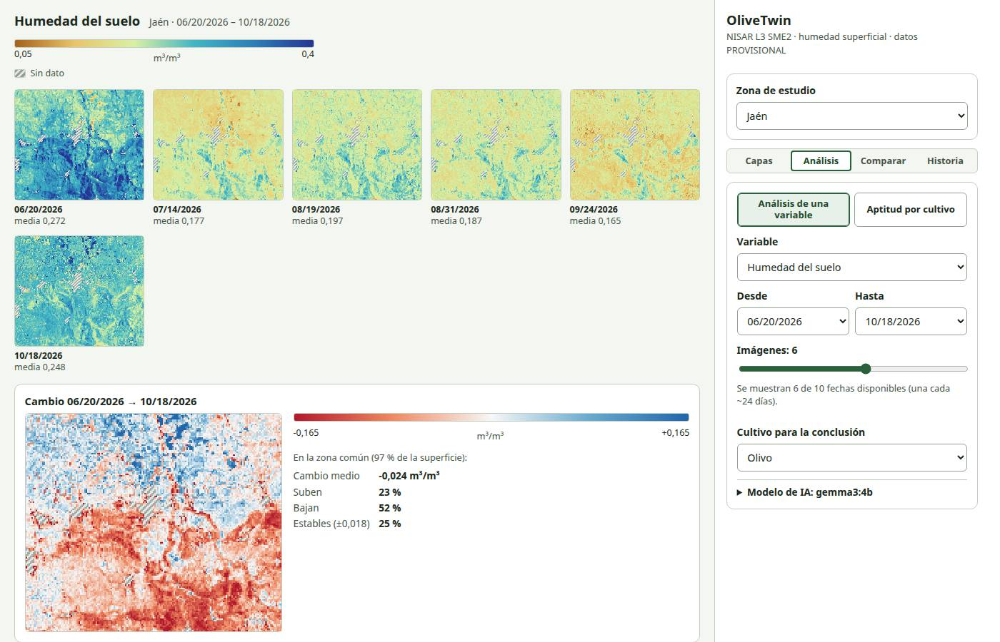
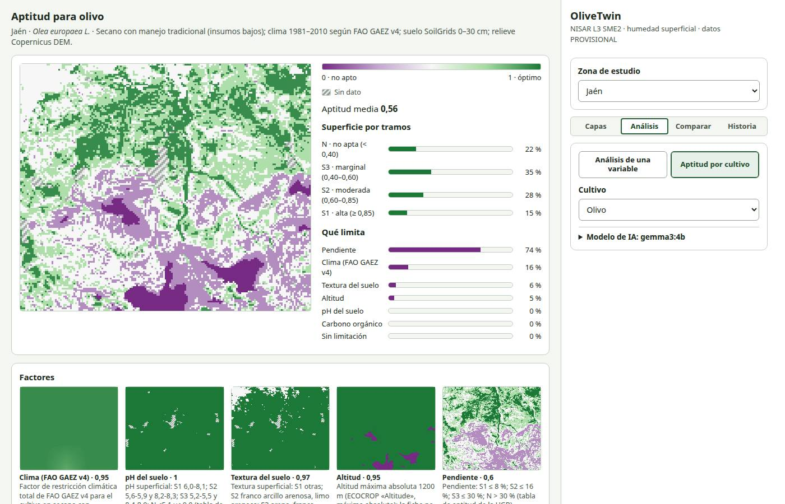
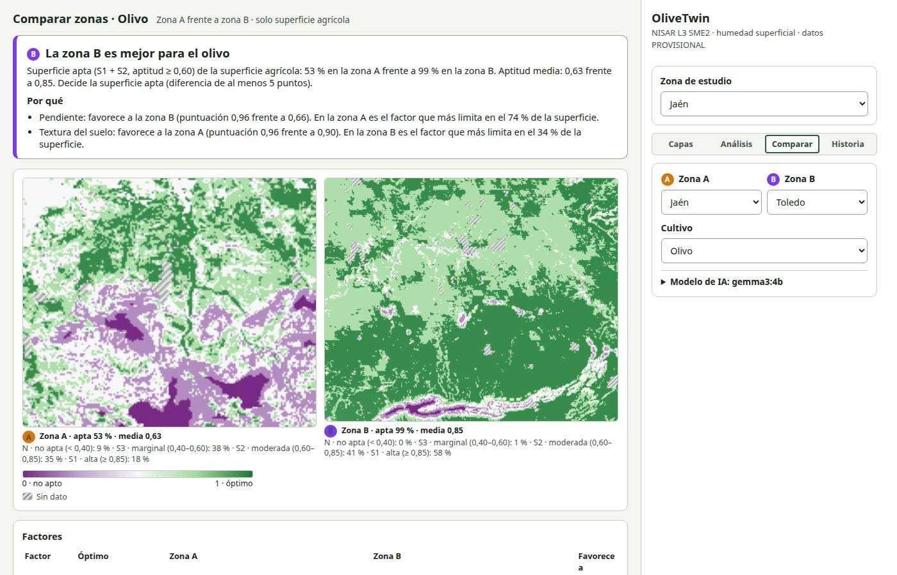

# OliveTwin

**Radar NISAR, vegetación, suelo y clima para saber qué zonas son mejores para el olivo, el almendro y el trigo.**

[](https://alros14.github.io/olivetwin/)
[](https://www.spaceappschallenge.org/2026/challenges/dancing-with-the-sars/)
[](https://github.com/AlRos14/olivetwin/actions/workflows/ci.yml)
[](LICENSE)

### ▶ [Abrir la demo: alros14.github.io/olivetwin](https://alros14.github.io/olivetwin/)

Funciona en el navegador, sin instalar nada ni registrarse.


## El reto

OliveTwin es nuestro proyecto para el **[NASA Space Apps Challenge 2026](https://www.spaceappschallenge.org/)**,
el hackatón internacional de la NASA, dentro del reto
**«[Dancing with the SARs](https://www.spaceappschallenge.org/2026/challenges/dancing-with-the-sars/)»**.
El reto pide una aplicación interactiva que use datos radar de la misión
**[NISAR](https://nisar.jpl.nasa.gov/)** (NASA-ISRO Synthetic Aperture Radar)
para seguir y visualizar cambios en la superficie terrestre.

El cambio que seguimos es la **humedad del suelo en zonas agrícolas**: cómo se
seca y se recarga el suelo durante el verano de 2026 en dos zonas olivareras de
España, Jaén y Toledo. La ponemos en contexto con vegetación, relieve, suelo y
clima para estimar qué zonas son más aptas para cada cultivo.

El radar es útil para esto porque mide de día y de noche, también con nubes, y
la señal es sensible al agua del suelo. El enunciado completo, los recursos
oficiales y la política de licencias están en [`docs/challenge.md`](docs/challenge.md).

## Qué puedes hacer

| Pestaña | Para qué sirve |
|---|---|
| **Capas** | Ver en el mapa cualquier variable (humedad del suelo, radar, vegetación, relieve, suelo, clima, usos del suelo) con su línea temporal, leyenda y una explicación de para qué sirve en el cultivo. Mapa base: satélite, parcelas agrícolas (SIGPAC) o callejero. |
| **Análisis** | Estudiar una variable: imágenes por fecha, mapa de cambio, gráficas y valores. Al elegir un cultivo, ver sus **valores de referencia** (óptimo, aceptable, no apto). También, **aptitud por cultivo**: mapa de aptitud, qué factor limita y dónde. |
| **Comparar** | Elegir **zona A**, **zona B** y un cultivo para saber cuál es mejor y por qué. |
| **Historia** | El reto, por qué usamos radar e hipótesis que la app permite explorar. |

| Análisis | Aptitud por cultivo | Comparar |
|---|---|---|
|  |  |  |

En Análisis y Comparar, **Interpretar con IA** pide a un modelo de lenguaje que
explique los resultados (opcional, ver [más abajo](#interpretación-con-ia-opcional)).

> ⚠️ **Datos provisionales.** La humedad NISAR SME2 todavía no está totalmente
> calibrada, mide solo los ~5 cm superficiales del suelo y **no equivale a una
> necesidad de riego**. La aptitud por cultivo es un modelo físico, no una
> predicción de cosecha.

## Los datos

Todo procede de fuentes abiertas o de uso libre para investigación.

| Grupo | Variables | Fuente |
|---|---|---|
| Radar NISAR | Humedad del suelo (SME2), radar HH, HV y HV/HH (GCOV), coherencia (GUNW) | NASA/JPL–ISRO, vía ASF DAAC |
| Humedad de referencia | Humedad del suelo SMAP | NASA, vía NSIDC DAAC |
| Vegetación | NDVI y NDMI | Copernicus Sentinel-2 |
| Relieve | Altitud y pendiente | Copernicus DEM |
| Suelo | Arcilla, arena, carbono orgánico y pH | ISRIC SoilGrids 2.0 |
| Clima | Lluvia, temperaturas, ET0 (diario) y clima medio 1991–2020 | Open-Meteo (ERA5) |
| Usos del suelo | Superficie agrícola y olivar | CORINE Land Cover 2018 |
| Aptitud por cultivo | Olivo, almendro y trigo de secano | Cálculo propio con FAO GAEZ v4, FAO ECOCROP y tablas de la Universidad de Granada |

Las zonas son dos recuadros de unos 35 × 30 km (Jaén) y 60 × 48 km (Toledo),
con una rejilla de ~200 m y datos de junio a octubre de 2026. La lista completa
de fuentes, licencias y atribuciones está en
[`docs/data-sources.md`](docs/data-sources.md); las atribuciones obligatorias,
en [`NOTICE`](NOTICE).

### Cómo se calcula la aptitud

Cada factor (clima, pH, textura, pendiente, carbono orgánico y altitud) se
puntúa de 0 a 1 según los requisitos publicados del cultivo, y la aptitud es el
**peor** de los factores. Se clasifica en S1 (alta, ≥ 0,85), S2 (moderada),
S3 (marginal) y N (no apta, < 0,40). En **Comparar** solo cuenta la superficie
agrícola, y gana la zona con más superficie apta (S1 + S2). El detalle y las
decisiones están en [`pipelines/analysis/README.md`](pipelines/analysis/README.md).

## Limitaciones

- **Productos NISAR provisionales.** Úsalos para ver cambios relativos, con
  cautela. Jaén se observa al amanecer (~05:23 UTC) y Toledo al atardecer
  (~19:09 UTC).
- **Huecos sin dato.** NISAR no estima humedad en zonas urbanas, agua o
  vegetación densa, y en Toledo la pasada cubre ~80 % desde mediados de agosto.
  Se marcan con trama gris; los cálculos usan solo la zona común con dato.
- **La aptitud es física, no de cosecha.** No mide el agua disponible para el
  rendimiento, la vecería, el manejo ni la rentabilidad, y no está validada con
  cosechas. Cada zona es el recuadro elegido, no su provincia.
- **La IA es orientativa.** Resume las estadísticas que recibe y puede
  equivocarse, sobre todo con modelos pequeños.
- **Depende de la red** para los mapas base. Las parcelas SIGPAC solo se ven al
  acercarse (zoom 15 o más).

## Ejecutarlo en tu ordenador

La [demo](https://alros14.github.io/olivetwin/) no necesita instalación. Para
ejecutarla en local hace falta **Node.js 22** (versión en [`.nvmrc`](.nvmrc)),
npm y conexión a Internet para los mapas base. Es una web estática: no hay
servidor ni base de datos, y los datos ya vienen en el repositorio.

```bash
git clone https://github.com/AlRos14/olivetwin.git
cd olivetwin/frontend
npm ci
npm run dev
```

Abre **<http://localhost:5173/>**. La zona de Jaén se selecciona sola; cambia
de zona arriba a la derecha y prueba las pestañas.

| Problema | Solución |
|---|---|
| `npm ci` falla | Comprueba que usas Node.js 22 (`node --version`; con nvm, `nvm use`). |
| El mapa base sale gris | No hay conexión o el servicio del mapa no responde: cambia de mapa base en Capas. |

### Interpretación con IA (opcional)

La app funciona sin IA. Para activarla con un modelo local y gratuito, instala
[Ollama](https://ollama.com) y, en otra terminal:

```bash
OLLAMA_ORIGINS="http://127.0.0.1:*,http://localhost:*,https://alros14.github.io" ollama serve
ollama pull gemma3:4b
```

Después pulsa **Interpretar con IA** en la app (local o la demo publicada; el
navegador puede pedir permiso para acceder a la red local). En «Modelo de IA»
puedes cambiar a cualquier otro servicio compatible con la API de OpenAI, por
ejemplo uno en la nube con tu clave; la clave solo se guarda durante la sesión
del navegador. Sin GPU, cada interpretación tarda unos minutos. Si da error de
conexión, usa «Probar conexión» en «Modelo de IA» y comprueba que `ollama serve`
está en marcha con `OLLAMA_ORIGINS` y que descargaste el modelo.

## Desarrollo

| Parte | Tecnología | Documentación |
|---|---|---|
| Web (`frontend/`) | Vue 3, Vite, TypeScript y Leaflet; web estática | [`frontend/README.md`](frontend/README.md) |
| Cubo de análisis (`pipelines/analysis/`) | Python 3.12: descarga y procesado de todas las variables | [`pipelines/analysis/README.md`](pipelines/analysis/README.md) |
| Conversor NISAR (`pipelines/nisar/`) | Python 3.12: SME2 (HDF5) a PNG georreferenciado | [`pipelines/nisar/README.md`](pipelines/nisar/README.md) |
| Contrato de datos (`contracts/`) | JSON Schema que valida los datos publicados | [`docs/data-contract.md`](docs/data-contract.md) |

Cada pull request pasa el check `ci`, que valida los datos, ejecuta las pruebas
de la web y de los dos pipelines y compila la web. Cada merge a `main` publica
la demo en GitHub Pages. Para regenerar los datos se necesita una cuenta
gratuita de [NASA Earthdata](https://urs.earthdata.nasa.gov/): los comandos
están en [`pipelines/analysis/README.md`](pipelines/analysis/README.md) y la
publicación de una zona nueva, en [`docs/handoff-science.md`](docs/handoff-science.md). Cómo colaborar:
[`docs/contributing.md`](docs/contributing.md).

## Créditos y agradecimientos

- **[NASA Space Apps Challenge](https://www.spaceappschallenge.org/)**, el
  hackatón internacional organizado por la NASA, y su reto
  **[Dancing with the SARs](https://www.spaceappschallenge.org/2026/challenges/dancing-with-the-sars/)**,
  que dio origen a este proyecto.
- **Misión [NISAR](https://nisar.jpl.nasa.gov/)**, de la NASA y la ISRO (Indian
  Space Research Organisation), con productos distribuidos por el
  **[ASF DAAC](https://asf.alaska.edu/)** (Alaska Satellite Facility).
- **NASA Earthdata** y el **NSIDC DAAC** (humedad del suelo SMAP).
- **Copernicus** (Unión Europea y ESA): Sentinel-2, Copernicus DEM y CORINE
  Land Cover; **ISRIC** (SoilGrids), **Open-Meteo** (ERA5), **FAO** (GAEZ y
  ECOCROP), **Universidad de Granada**, **IGN** (PNOA), **FEGA** (SIGPAC) y
  **OpenStreetMap**.

El equipo está en los [contribuidores del repositorio](https://github.com/AlRos14/olivetwin/graphs/contributors).

> La NASA no avala este proyecto. OliveTwin es un trabajo independiente del
> equipo para el NASA Space Apps Challenge, y el uso de datos de la NASA no
> implica su respaldo.

## Licencia y cita

El código de OliveTwin es **[Apache-2.0](LICENSE)**: puedes usarlo, modificarlo
y redistribuirlo citando la autoría (incluye [`NOTICE`](NOTICE)). Los datos
conservan las licencias de sus fuentes: algunas (FAO ECOCROP y FAO GAEZ) solo
permiten usos **no comerciales**; ver [`docs/data-sources.md`](docs/data-sources.md).

Si usas OliveTwin en una investigación o presentación, cítalo con
[`CITATION.cff`](CITATION.cff) («Cite this repository» en GitHub).
