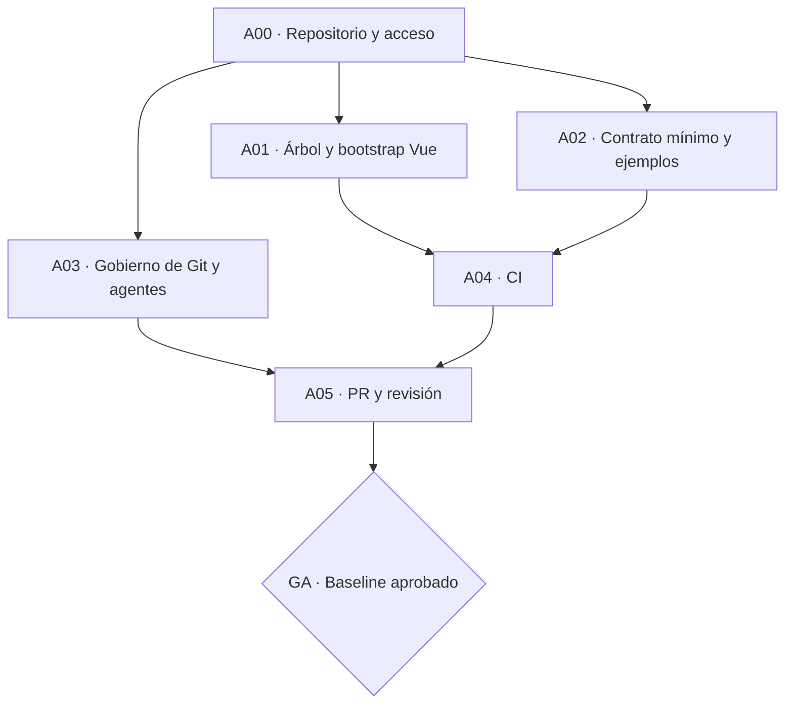

# OliveTwin — Fase A: baseline inicial de GitHub

> **Nota de archivo:** este documento se conserva como registro del plan de
> Fase A. Su diagrama DAG (`OliveTwin_Fase_A_DAG.png`) **no se versiona** en el
> repositorio; el diagrama Mermaid y el respaldo en texto incluidos más abajo
> son la referencia. Para el estado real de los nodos, consulta el
> [índice de work packets](README.md) y [`docs/baseline-review.md`](../baseline-review.md).

**Estado:** plan de implementación; **no ejecutado**.  
**Alcance:** únicamente Fase A; no iniciar WP-04 ni WP-07 hasta superar GA.  
**Proyecto:** OliveTwin / NASA Space Apps Challenge 2026 — *Dancing with the SARs*.  
**Versión del plan:** A.1 — 14 de noviembre de 2026.

## 0. Instrucción ejecutiva para el orquestador

Inspecciona si el repositorio OliveTwin ya existe. **No crees otro ni sobrescribas cambios previos si existe.** Prepara un baseline mínimo mediante una única PR; descompón A01, A02 y A03 en tareas paralelas con ámbitos de escritura separados, integra A04, ejecuta CI, solicita revisión independiente y entrega un informe PASS/FAIL de GA. No comiences la implementación de WP-04/07 ni la obtención o simulación de capas científicas en esta fase. Si una decisión de acceso (propietario de repo, permisos, publicación) no se puede resolver con los permisos disponibles, documéntala como bloqueo concreto en vez de inventarla.

**Resultado que habilita:** ejecución simultánea de **WP-04 (contratos completos, generador/loader de datos)** y **WP-07 (Vue + Leaflet y UI)** según el plan v2 ya acordado. El bootstrap y el congelamiento mínimo del contrato de la Fase A sustituyen los nodos PRE00/PRE01/PRE02/C0 de ese plan: no duplicarlos en Fase B.

### Decisiones ya aprobadas

- Un único **monorepositorio**; rama `main` siempre compilable; ramas cortas y PR pequeñas.
- Aplicación estática con **Vue 3 + Vite + TypeScript**; Leaflet y UI se implementarán en WP-07, **no** en Fase A.
- España navegable (Península, Baleares y Canarias), con mapa base PNOA/IGN por defecto y OSM alternativo **en WP-07**.
- Capas científicas por zonas de estudio, no para toda España: **NDVI** óptico y **humedad superficial** (futura SME2), visualizadas como imágenes superpuestas con metadatos JSON.
- Dos modos de datos seleccionables en la interfaz futura: `sample` y `real`; inicialmente `real` sin zonas; nunca reemplazar silenciosamente mediciones reales por ejemplos.
- Datos HDF5, GeoTIFF intermedios y otros ficheros grandes no se versionan directamente en Git. Publicar solo assets optimizados en `frontend/public/data/`.
- Mantener el contrato **v1.1.0** y la convención espacial `bbox = [west,south,east,north]`, EPSG:4326. Los PNG finales para `ImageOverlay` se preparan sobre una cuadrícula adecuada para Web Mercator, georreferenciados mediante `bbox` y validaciones del pipeline.

## 1. Sub-DAG




Respaldo textual: `A00 -> (A01 || A02 || A03); (A01 + A02) -> A04; (A03 + A04) -> A05 -> GA`.

### Matriz de work packets

| Nodo | Responsable funcional | Dependencias | Scope de escritura | Resultado |
|---|---|---|---|---|
| A00 | Administrador del repositorio | — | Configuración GitHub y rama bootstrap | Repo existente inspeccionado o creado, acceso verificado |
| A01 | Responsable de bootstrap | A00 | `frontend/`, `.gitignore`, `.nvmrc`, carpetas vacías con `.gitkeep` | Vue + Vite + TS compila; estructura precreada |
| A02 | Responsable de contratos | A00 | `contracts/`, `frontend/public/data/{sample,real}/manifest.json`, `docs/contract-freeze.md` | Contrato mínimo v1.1.0 congelado, manifiestos vacíos válidos |
| A03 | Responsable de colaboración | A00 | `README.md`, `AGENTS.md`, `.github/PULL_REQUEST_TEMPLATE.md`, `docs/contributing.md` | Reglas claras de ramas, permisos, PR, scopes y revisión |
| A04 | Responsable de CI | A01, A02 | `.github/workflows/ci.yml`, `frontend/scripts/validate-data.*`, config de validación | Build de Vite + verificación de JSON en PR |
| A05 | Revisor independiente | A03, A04 | PR, informe `docs/baseline-review.md` | PR revisada; CI verde; bloqueos identificados |
| GA | Responsable de proyecto | A05 | Estado de la PR y decisión de aprobación | Baseline fusionado y permiso de arranque de Fase B |

**Conflicto a evitar:** A01 no modifica `frontend/public/data/` (lo reserva A02); A02 no edita `frontend/src/` (propiedad de WP-04/07 en B); A04 no edita `package.json` sin coordinación explícita con A01. Cuando una tarea requiera un archivo ajeno, abrir solicitud al owner, no sobrescribirlo.

## 2. A00 — Repositorio y permisos

**Acciones:** verificar si ya existe el repositorio elegido (nombre sugerido `olivetwin`), su owner, visibilidad, remotos y ramas; reutilizarlo si existe; comprobar que los seis colaboradores disponen de acceso adecuado; establecer `main` como rama principal. Si se crea de cero, inicializar solo con README mínimo para que exista una base desde la que abrir `bootstrap/phase-a`.

**Entregable:** URL real del repositorio, lista de colaboradores autorizados y rama `bootstrap/phase-a` (o nombre equivalente). **No inventar URL ni permisos.**

**Aceptación:** todos pueden clonar y abrir PR, pero nadie necesita permiso para hacer push directo a `main`. Las credenciales de agentes y personas deben estar distinguidas cuando haya aprobación humana exigida.

## 3. A01 — Estructura y bootstrap

Crear el proyecto inicial en `frontend/` con el template oficial `vue-ts`:

```bash
npm create vite@latest frontend -- --template vue-ts
cd frontend
npm install
npm run build
```

Elegir y fijar una versión de Node compatible con Vite (por ejemplo 22 LTS en `.nvmrc`, comprobando la versión mínima exacta del template que se instale) y versionar `frontend/package-lock.json`. No instalar Vue Router, Pinia, biblioteca de estilos ni añadir Leaflet todavía, para preservar el alcance de WP-07.

### Árbol mínimo propuesto

```text
olivetwin/
├── frontend/
│   ├── public/data/
│   │   ├── sample/manifest.json       # A02: zones=[] en Fase A
│   │   └── real/manifest.json         # A02: zones=[] en Fase A
│   ├── src/                            # Template Vue mínimo; WP-07 en B
│   ├── package.json
│   ├── package-lock.json
│   └── vite.config.ts
├── contracts/
│   ├── manifest.schema.json           # A02, contrato mínimo
│   └── README.md
├── pipelines/
│   ├── nisar/.gitkeep
│   ├── vegetation/.gitkeep
│   └── historical/.gitkeep
├── data/
│   └── references/.gitkeep
├── scripts/.gitkeep                   # Publicador científico: fase posterior
├── docs/
│   ├── contract-freeze.md
│   ├── contributing.md
│   └── work-packets/.gitkeep
├── .github/
│   ├── workflows/ci.yml
│   └── PULL_REQUEST_TEMPLATE.md
├── .gitignore
├── .nvmrc
├── AGENTS.md
└── README.md
```

`.gitignore` debe excluir `node_modules/`, `dist/`, `.env*` excepto ejemplo explícito y artefactos científicos grandes (`*.h5`, `*.hdf5`, `*.tif`, `*.tiff`, `*.nc`), documentando excepciones si en el futuro fuese necesario versionar una prueba pequeña. No incluir muestras reales en Phase A; el generador de PNG y Jaén/Toledo corresponde a WP-04.

**Aceptación:** `cd frontend && npm ci && npm run build` pasa y aparece `frontend/dist/`. Un desarrollador puede iniciar con `npm run dev`.

## 4. A02 — Congelar contrato mínimo v1.1.0

No definir todavía la lógica del loader ni el JSON Schema científico completo: eso es **WP-04**. Congelar las interfaces que ambos paquetes necesitan para avanzar sin romperse.

### Manifiestos iniciales

`frontend/public/data/sample/manifest.json`:

```json
{
  "schemaVersion": "1.1.0",
  "datasetMode": "sample",
  "appTitle": "OliveTwin",
  "zones": []
}
```

`frontend/public/data/real/manifest.json`:

```json
{
  "schemaVersion": "1.1.0",
  "datasetMode": "real",
  "appTitle": "OliveTwin",
  "zones": []
}
```

La ausencia de zonas es intencionada: **Fase A prepara contratos, no enseña todavía capas**. El modo `real` vacío seguirá siendo válido después.

### Campos y convenciones inmutables para Fase B

| Objeto | Campos mínimos/convenios | Propiedad del trabajo posterior |
|---|---|---|
| Manifest | `schemaVersion`, `datasetMode` (`sample`/`real`), `appTitle`, `zones[]` | WP-04 completa el schema |
| Zona | `id`, `name`, `bbox`, `layers[]` | WP-04 formaliza JSON Schema; WP-07 visualiza |
| Capa | `id` (`ndvi` o `soil-moisture`), `title`, `kind: image-overlay`, `image`, `bbox`, `imageCrs`, `unit`, `status`, `legend`, `provenance`, `qualityNote` | WP-04 define restricciones/validador; WP-07 usa props |
| BBox | `[west, south, east, north]`, WGS84 EPSG:4326; Leaflet recibe `[[south,west],[north,east]]` | No cambiar orden sin versión mayor |
| Capa PNG | PNG RGBA + `bbox` de imagen, CRS de presentación adecuado, transparencia de nodata | WP-04 genera muestra; científicos producen real |
| Modo | `sample` / `real` en runtime; nunca fallback silencioso | WP-04 estado, WP-07 selector UI |
| Estado de carga | `loading`, `ready`, `empty`, `error` | WP-04 servicio/composable |
| Mapa base | `pnoa` / `osm` | WP-07 |
| Rutas | `image` relativa a `public/`, sin `/` inicial y sin `..`; resolver con `import.meta.env.BASE_URL` | WP-04 carga, WP-07 no crea rutas |
| Procedencia | `synthetic` vs `processed_real`; no presentar datos inventados como NASA real | Aprobación científica cuando haya real |

**Tipado mínimo compartido de referencia:**

```ts
export type DataMode = 'sample' | 'real';
export type BaseMap = 'pnoa' | 'osm';
export type ManifestLoadStatus = 'loading' | 'ready' | 'empty' | 'error';
export type BBox = [west: number, south: number, east: number, north: number];
```

Documentar en `docs/contract-freeze.md` el acuerdo con los responsables de WP-04 y WP-07. El archivo `frontend/src/types/manifest.ts` se materializará en WP-04 a partir de este acuerdo; si se crea un stub en A, transferir ownership para que no haya un segundo módulo competidor.

**Aceptación:** los dos JSON iniciales pasan parseo y un schema mínimo que prohíbe un `datasetMode` no reconocido y exige `zones` como array. Las ampliaciones de campos del contrato en WP-04 deben ser aditivas o aprobadas como cambio de interfaz.

## 5. A03 — Gobierno de colaboración y agentes

Crear:

- **README.md:** propósito, mapa de módulos, arranque local y límites científicos; enlaces a work packets.
- **AGENTS.md:** reglas para agentes: inspeccionar antes de escribir, editar solo su scope, worktree/rama propios, correr checks, presentar evidencias, **no fusionar**, no afirmar hechos científicos no validados.
- **docs/contributing.md:** PR pequeñas, `main` siempre compilable, convención `wp04/...`, `wp07/...`, `wp02/...`, `bootstrap/...`; preferir *squash merge*; no subir HDF5 pesados.
- **.github/PULL_REQUEST_TEMPLATE.md:** Issue/WP, dependencias, cambios, pruebas, ficheros modificados, procedencia de datos, riesgos, revisión y capturas si UI.

Cada work packet tiene un **owner humano**, puede delegar implementación a agentes y requiere **revisión independiente**. Si dos agentes usan las mismas credenciales que el revisor humano, GitHub no permite distinguir la aprobación por identidad; complementar con control fuera de esa cuenta o una cuenta de bot separada. No hacer pasar un comentario automatizado por aprobación personal.

Los contratos compartidos y `.github/workflows/` necesitan revisión de integración. No crear un `CODEOWNERS` con usuarios ficticios: completarlo cuando se conozcan las identidades reales.

**Protección de `main`:** una vez que exista el check real de CI, configurar PR obligatoria y check requerido (nombre estable, p. ej. `ci`). Aprobación humana requerida cuando lo permita el plan/configuración del repositorio. Evitar bloquear la primera PR exigiendo un check que todavía no se ha ejecutado. Reglas y disponibilidad según visibilidad/plan.

**Aceptación:** cualquier colaborador comprende dónde abrir una Issue, qué archivos puede editar y qué necesita su PR para integrarse.

## 6. A04 — CI mínima

Crear `.github/workflows/ci.yml` ejecutado en `pull_request` y, opcionalmente, `push` a `main` para diagnóstico. Un solo job con nombre estable `ci`:

1. Checkout.
2. Setup Node acorde con `.nvmrc`, con caché apuntando a `frontend/package-lock.json`.
3. `npm ci --prefix frontend`.
4. Validar JSON iniciales contra el schema mínimo (script pequeño versionado bajo `frontend/scripts/`, con dependencia de validación instalada y fijada por A01/A04 coordinadamente).
5. `npm run build --prefix frontend`.

No exigir todavía pruebas de Leaflet, cartografía, overlays o E2E: pertenecen a WP-07 / integración B. WP-04 ampliará el esquema y el validador semántico y añadirá nuevos test cases.

**Casos negativos mínimos del validador:** rechazar modo `unknown`, `zones: null` y falta de `schemaVersion`; aceptar `sample`/`real` con `zones: []`.

**Aceptación:** la PR no queda verde solo porque npm instale; verifica el build y los dos manifiestos. El check tiene un nombre reconocible para protección de rama.

## 7. A05 y GA — Revisión y autorización de fase B

**Secuencia:** inspeccionar diffs; ejecutar localmente `npm ci`, `npm run build` y validación de JSON; revisar que los módulos no se solapan; comprobar CI verde en GitHub; verificar PR de baseline, resolver comentarios y fusionar cuando se apruebe. Después activar protección de `main` con el check ya creado, si permisos y plan lo permiten.

### Checklist de aceptación GA

- [ ] Repositorio correcto, permisos de acceso y `main` verificables.
- [ ] PR única de baseline integrada; no se han pisado cambios anteriores.
- [ ] `frontend` arranca y compila desde instalación limpia.
- [ ] `contracts/` y `docs/contract-freeze.md` documentan v1.1.0, modos, `bbox` y rutas.
- [ ] Manifiestos `sample` y `real` vacíos, parseables y validados.
- [ ] CI se ejecuta en PR y falla ante contrato inválido.
- [ ] `AGENTS.md`, CONTRIBUTING y template de PR disponibles.
- [ ] Existen carpetas para datos NISAR, NDVI e históricos, sin binarios grandes.
- [ ] Definidos owners de **WP-04** (`contracts/`, loader, manifests) y **WP-07** (Vue UI/Leaflet); scopes documentados.
- [ ] Registradas las limitaciones de protección de `main`, si las hubiera.

**Cierre GA:** PASS si todo lo esencial se cumple. Si un requisito de permisos no se puede aplicar, el bloqueo o excepción debe registrarse y aprobarse expresamente; no declarar que está protegido si no lo está.

## 8. Handoff exacto a Fase B

Una vez superado GA, **no repetir el bootstrap ni renegociar el contrato básico**. El orquestador del plan WP-04/WP-07 debe marcar como ya satisfechos `PRE00`, `PRE01`, `PRE02` y `C0`, y lanzar dos ramas:

```text
                   ┌─ WP-04: schema completo, fixtures, modo sample/real,
GA (Fase A) ───────┤         loader, validación científica de archivos
                   └─ WP-07: Leaflet PNOA/OSM, zona/capas, overlays,
                             controles, leyenda y avisos
                    ↓
                Integración + QA + demo de la demo
```

**Límite Fase A:** sin datos sintéticos visuales todavía, sin PNG, sin mapa implementado, sin resultado de NISAR, sin despliegue público obligatorio. El hosting estático, configuración `base` de Vite, deployment Pages y el mapa final se comprueban durante Fase B, cuando exista la aplicación.

## 9. Referencias técnicas verificadas

- Vite: template Vue-TS y requisitos de Node: https://vite.dev/guide/
- GitHub: protección de ramas y checks: https://docs.github.com/en/repositories/configuring-branches-and-merges-in-your-repository/managing-protected-branches/about-protected-branches
- Vite: despliegue GitHub Pages y `base` en subruta: https://vite.dev/guide/static-deploy

