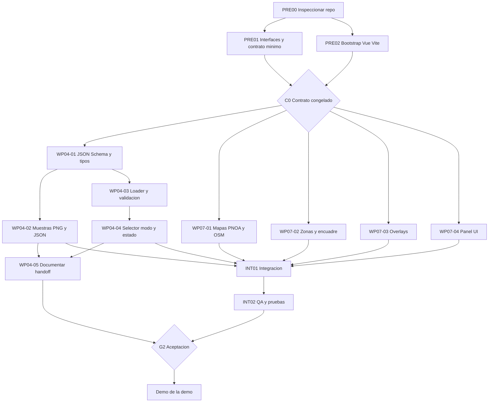

# OliveTwin — Plan de implementación actualizado: WP-04 + WP-07 en paralelo

> **Nota de archivo:** este documento se conserva como registro del plan v2 de
> la «demo de la demo». Su diagrama DAG (`OliveTwin_WP04_WP07_DAG.png`) **no se
> versiona** en el repositorio; el diagrama Mermaid y el respaldo en texto
> incluidos más abajo son la referencia. Para el estado real de los nodos,
> consulta el [índice de work packets](README.md) y
> [`docs/qa-results.md`](../qa-results.md).

**Tipo:** work packet maestro de ejecución para un orquestador multiagente.  
**Fecha:** 14 de noviembre de 2026.  
**Versión:** 2.0 del plan de la «demo de la demo»; sustituye el plan anterior limitado a WP-04.  
**Resultado esperado:** aplicación estática **funcionando**, construida con Vue 3 + Vite + TypeScript + Leaflet, que navega por España y permite mostrar capas de **vegetación (NDVI)** y **humedad superficial** en zonas delimitadas. Datos **de muestra** activables mediante un control dentro de la interfaz; preparación explícita para incorporar capas científicas reales después, sin cambiar los componentes de presentación.

> **Instrucción ejecutiva:** inspecciona el repositorio, materializa este sub-DAG y **ejecútalo hasta entregar una demo operativa**. No te detengas tras planificar. Respeta los ámbitos de archivos, lanza ramas independientes en paralelo y exige revisión independiente. No hagas merges masivos sin pruebas. Si faltan datos reales, **no bloquees esta entrega**: el modo muestra es suficiente para este paquete, siempre que esté claramente señalado.

---

## 1. Contexto del producto y propósito

**OliveTwin** se plantea para el reto «Dancing with the SARs» del NASA Space Apps Challenge 2026. La visión futura consiste en investigar por qué dos olivares cercanos, aparentemente similares, pueden producir cantidades persistentemente distintas, combinando observaciones radar NISAR, vegetación, humedad, suelo y registros de cosechas. Esto **no significa** que un radar mida directamente producción, estrés hídrico o causas agronómicas; las inferencias científicas requieren datos compatibles y validación.

**Situación actual del equipo:** otras personas trabajan en localización, adquisición y procesamiento de datos NISAR y fuentes agrícolas. Para no bloquear desarrollo ni presentación, estos dos work packets construyen la **«demo de la demo»**: una experiencia interactiva con datos **sintéticos y expresamente identificados**, que se puedan reemplazar más adelante por archivos preparados por el pipeline científico.

**Objetivo demostrable de esta entrega:** abrir la aplicación, ver un mapa de toda España, cambiar entre **Ortofoto PNOA** y **Mapa de calles OpenStreetMap**, seleccionar una de dos zonas de estudio ficticias (Jaén y Toledo), activar **vegetación** o **humedad**, variar su opacidad, inspeccionar leyenda/metadatos, cambiar entre **Datos de muestra** y **Datos reales**, y entender la diferencia entre un modo sintético funcional y un modo real actualmente sin contenido. La interfaz no debe sugerir que los colores inventados provienen de NASA.

**No obligatorio en esta entrega:** SIGPAC, comparador de parcelas A/B, kg/ha, datos de cooperativas o UPM/Universidad de Jaén, entrenamiento de IA, predicción, análisis de humedad por árbol, series temporales y consultas por píxel. No impedir su incorporación posterior.

### Distinción entre mapa base y datos científicos

- **Mapa base PNOA / IGN:** teselas de ortofoto o imagen Sentinel-2 según la escala; sirve para orientación visual. **No es la capa NISAR**, ni tiene por qué coincidir temporalmente con ella.
- **Mapa base OSM:** representación cartográfica alternativa de calles y localidades.
- **NDVI:** índice de vegetación óptico (en implementación real puede venir de Landsat o Sentinel-2); **no lo produce NISAR**.
- **Humedad superficial:** en la futura integración puede derivarse de NISAR SME2; **no equivale a humedad profunda ni implica una dosis de riego**. La resolución nominal de SME2 limita su uso a parcelas suficientemente grandes y comparaciones cuidadosas.
- **Overlays PNG:** representación visual previamente calculada. Sus colores no permiten recuperar valores científicos exactos; un `values.json` numérico podrá incorporarse como ampliación posterior.

---

## 2. Decisiones técnicas cerradas

| Categoría | Decisión |
|---|---|
| Aplicación | Vue 3, Composition API, Vite, TypeScript, pantalla principal única |
| Mapa | Leaflet directamente, sin wrapper obligatorio |
| Base predeterminada | PNOA Máxima Actualidad, servicio XYZ/TMS oficial del IGN/CNIG |
| Base alternativa | OpenStreetMap estándar; atribución visible |
| Cobertura navegable | España: Península, Baleares y Canarias; sin restringir la navegación únicamente a las zonas de muestra |
| Cobertura científica | Solo zonas presentes en cada manifiesto; no colorear el resto del mapa |
| Capas P0 | `ndvi` y `soil-moisture`, una científica visible cada vez |
| Archivos por zona | PNG RGBA transparente por capa + `bbox` y metadatos JSON |
| Modo datos | Selector en el **frontend**: `sample` / `real`, sin recompilar ni cambiar variables de entorno |
| Primer arranque | `sample` por defecto, aviso permanente «DATOS SIMULADOS» cuando proceda |
| Real sin contenido | Estado explícito «Aún no hay datos reales disponibles»; no hacer fallback silencioso a muestra |
| Manifiestos | `public/data/sample/manifest.json` y `public/data/real/manifest.json`, esquema compartido |
| Base URL | Resolver URLs usando `import.meta.env.BASE_URL`; compatible con ruta de subdirectorio |
| Runtime | SPA estática, sin backend, DB, autenticación, APIs propias ni claves en cliente |
| Estado | Composables y props/emits; evitar Pinia y Vue Router en P0 |
| QA | Tests unitarios de contratos/servicios + E2E o prueba visual documentada + build estático |
| Disponibilidad offline | No se exige: los mapas base dependen de servicios externos accesibles por Internet |

**Origen cartográfico verificado:** el IGN ofrece ortofotos PNOA de Máxima Actualidad para España, utilizando imágenes Sentinel-2 a escalas pequeñas y ortofotografías al acercarse. En catálogo público figura esta URL TMS de teselas raster:  
`https://tms-pnoa-ma.idee.es/1.0.0/pnoa-ma/{z}/{x}/{-y}.jpeg`  
Leaflet admite la variable `{-y}` para TMS; **no usar `tms: true` simultáneamente con `{-y}`** sin verificar el comportamiento. La URL y accesibilidad real deben probarse en el navegador. El servicio externo puede fallar o limitar peticiones; dejar al usuario cambiar manualmente a OSM y no eliminar atribuciones.

Fuentes: https://pnoa.ign.es/web/portal/pnoa-imagen/visualizadores-y-servicios-web · https://datos.gob.es/es/catalogo/e0dat0002-ortofotos-pnoa-anual-de-2025-maxima-actualidad · https://leafletjs.com/examples/wms/ · https://vite.dev/guide/env-and-mode

---

## 3. Separación formal de responsabilidades

### WP-04 — Arquitectura, contratos y datos

**Es dueño de:** schema, tipos compartidos, manifiestos, generador de datos simulados, ruta de assets, validador, loader, repositorio/composable del estado `sample`/`real`, documentación de handoff científico. **No implementa la vista del mapa ni los componentes UI.**

Entregables independientes:

1. Contrato v1.1.0 congelado y ejemplos válidos/erróneos.
2. `data/sample/manifest.json`, dos zonas con dos PNG sintéticos cada una.
3. `data/real/manifest.json` válido y vacío (sin fingir que hay resultados NISAR).
4. Servicio para cargar cada manifiesto y resolver assets con Vite BASE_URL.
5. API/composable para alternar modos y zona/capa seleccionada con estados `loading`, `ready`, `empty`, `error`.
6. Validadores y guía para añadir una zona real más adelante sin editar `.vue`.

### WP-07 — Frontend, cartografía e interacción

**Es dueño de:** mapa Leaflet, elección de mapa base, presentación de zonas, overlays y su opacidad, panel de selección y leyendas, diseño responsive/accesibilidad, avisos de muestra y vacío. **No genera datos científicos ni redefine el JSON Schema.**

Entregables independientes:

1. Mapa Leaflet de España y elección **PNOA / OSM**.
2. Marcadores/perímetros de zonas declaradas por el proveedor de datos.
3. Overlays PNG por `bbox`, una capa activa, limpieza correcta al cambiar modo y zona.
4. Selector de zona y variable, opacidad 0–100 %, leyenda, fuente y fecha.
5. Selector visible **Datos de muestra / Datos reales**; mensajes correctos si falta información.
6. Interfaz responsive, presentable y sin controles ficticios inertes.

### Roles funcionales para distribuir sin conocer al equipo

Seis roles anónimos: **R1 Orquestación e integración**, **R2 Contratos y lógica de datos**, **R3 Generación de datos de muestra**, **R4 Cartografía**, **R5 Frontend y UX**, **R6 QA y documentación**. Cada nodo tiene un solo rol *owner*; los revisores son independientes. La asignación a personas se hace fuera de este documento.

### Regla de simultaneidad

**WP-04 y WP-07 se ejecutan en paralelo después de un pequeño Gate C0 compartido.** Este gate solo establece el esqueleto del repo y congela interfaces mínimas (nombres de campos, tipos y semántica de los eventos) para evitar colisiones. No espera a que el generador de muestras o el servicio de datos estén terminados. WP-07 implementa contra las interfaces y fixtures contractuales aprobados; WP-04 implementa su proveedor real de archivos estáticos. Se integran cuando ambos cumplen el mismo contrato.

---

## 4. Contrato de datos v1.1.0 — fuente de verdad de ambos WPs

La versión 1.1.0 sustituye al borrador 1.0.0 **antes de comenzar la implementación**: añade `datasetMode` en el manifiesto para asegurar que el selector no mezcle datos sintéticos y reales.

### 4.1 Estructura

```text
olivetwin/
├── contracts/
│   ├── manifest.schema.json
│   └── README.md
├── frontend/
│   ├── public/data/
│   │   ├── sample/
│   │   │   ├── manifest.json
│   │   │   └── zones/
│   │   │       ├── jaen-demo/{ndvi.png,moisture.png}
│   │   │       └── toledo-demo/{ndvi.png,moisture.png}
│   │   └── real/
│   │       ├── manifest.json             # inicialmente zones: []
│   │       └── zones/                   # se rellena cuando lleguen datos validados
│   ├── src/
│   │   ├── types/manifest.ts            # WP-04
│   │   ├── services/                    # WP-04
│   │   ├── composables/                 # WP-04
│   │   ├── components/                  # WP-07
│   │   ├── App.vue                      # integración
│   │   └── main.ts
│   └── package.json
├── scripts/generate-sample-data.*       # WP-04
├── scripts/validate-data.*              # WP-04
├── tests/                               # QA
└── docs/                                # plan, handoff, QA y créditos
```

### 4.2 Convenciones geoespaciales

- `bbox` = `[west, south, east, north]` en **WGS84, EPSG:4326**, grados geográficos. Para Leaflet: `[[south, west], [north, east]]`.
- `zone.bbox` define área de estudio; `layer.bbox` define cobertura del raster, que **puede ser menor**.
- Cada PNG de overlay es **imagen RGB/RGBA preparada en EPSG:3857**, norte arriba, extensión exacta del `layer.bbox`; sin datos: píxeles con alpha 0. La posición se transporta con JSON, no con el PNG.
- Una capa raster de imagen no expone valores científicos clicables. No inferir valor de humedad desde colores ni prometer consulta puntual. `values`/grid numérico puede añadirse como P1 con contrato propio.
- `status` de capa: `synthetic` o `processed_real`; coherente con `datasetMode` de manifiesto: sample admite exclusivamente synthetic; real exclusivamente processed_real.
- `processed_real` exige origen verificable, fecha de adquisición, identificador de producto o escena, versión de procesamiento y advertencias de calidad. No conceder este estado por cambiar un texto o un nombre de archivo.
- Una zona puede tener solo una capa o `layers: []`. Ninguna celda sin dato se representa con humedad cero.
- Todas las rutas `image` son relativas al `public/` raíz (sin barra inicial, `..` ni URLs externas arbitrarias); deben concatenarse con `import.meta.env.BASE_URL` para builds en subruta.
- Evitar NDVI representado como producto NISAR. NDVI = índice óptico; SME2 = humedad superficial estimada; GCOV = respuesta radar, extensión opcional.

### 4.3 Ejemplo mínimo de `sample/manifest.json`

```json
{
  "schemaVersion": "1.1.0",
  "datasetMode": "sample",
  "appTitle": "OliveTwin",
  "zones": [
    {
      "id": "jaen-demo",
      "name": "Jaén — demostración",
      "description": "Ubicación ilustrativa; sin afirmar que sea una parcela real",
      "bbox": [-3.86, 37.69, -3.61, 37.90],
      "layers": [
        {
          "id": "ndvi",
          "title": "Vegetación (NDVI)",
          "kind": "image-overlay",
          "variable": "NDVI",
          "image": "data/sample/zones/jaen-demo/ndvi.png",
          "bbox": [-3.86, 37.69, -3.61, 37.90],
          "imageCrs": "EPSG:3857",
          "unit": "index",
          "range": [-1, 1],
          "legend": [
            {"value": -1, "color": "#8c510a", "label": "Bajo"},
            {"value": 0, "color": "#dfc27d", "label": "Intermedio"},
            {"value": 1, "color": "#01665e", "label": "Alto"}
          ],
          "status": "synthetic",
          "provenance": {
            "provider": "Generador sintético",
            "product": "NDVI ilustrativo — no satelital",
            "acquisitionDate": null,
            "sceneId": null,
            "processingVersion": "sample-v1",
            "referenceUrl": null,
            "note": "Datos inventados para probar la interfaz"
          },
          "qualityNote": "NO apto para decisiones agronómicas"
        }
      ]
    }
  ]
}
```

Este JSON es **un ejemplo parcial**. WP-04 debe producir en el paquete final Jaén + Toledo, cada una con **NDVI y humedad**; los cuatro PNG son sintéticos y tienen una escala y una leyenda coherentes.

### 4.4 Ejemplo inicial de `real/manifest.json`

```json
{
  "schemaVersion": "1.1.0",
  "datasetMode": "real",
  "appTitle": "OliveTwin",
  "zones": []
}
```

Tener un manifiesto real vacío es una situación **válida**, no un error. Permite probar hoy el selector sin inventar observaciones de NASA.

### 4.5 Interfaz mínima entre WP-04 y WP-07 (fijar en C0)

```ts
export type DataMode = 'sample' | 'real';
export type BaseMap = 'pnoa' | 'osm';
export type ManifestLoadStatus = 'loading' | 'ready' | 'empty' | 'error';
export type BBox = [west: number, south: number, east: number, north: number];

export interface OliveTwinViewModel {
  dataMode: DataMode;
  loadStatus: ManifestLoadStatus;
  zones: StudyZone[];
  selectedZoneId: string | null;
  selectedLayerId: string | null;
  overlayVisible: boolean;
  overlayOpacity: number;   // 0...1 (display slider 0...100%)
  errorMessage: string | null;
}

// Los nombres reales de StudyZone y StudyLayer los define el JSON Schema.
// El frontend recibe el view-model y emite solicitudes de cambio;
// no construye rutas ni lee los archivos directamente en los componentes.
```

**Recomendación de arquitectura:** `App.vue` controla el view-model y pasa props a mapa y paneles; WP-04 proporciona `useOliveTwinData()` (o servicio equivalente) con acciones `setDataMode`, `selectZone`, `selectLayer`, `setOpacity`, `setOverlayVisible`. Fijar nombres/semántica en C0 y no cambiarlos unilateralmente.

---

## 5. Anexo A — modo «Datos de muestra» activable desde el frontend (P0 obligatorio)

Este anexo es **parte obligatoria** de ambos work packets y de su aceptación. No basta con activar un `.env`: el usuario tiene que poder hacerlo desde un control visible dentro de la aplicación.

### 5.1 Experiencia de usuario

1. Al abrir la app se selecciona **Datos de muestra** (por defecto). El mapa PNOA/OSM es real como base cartográfica; las **capas científicas** son sintéticas.
2. Junto al selector de zona aparece un control claramente etiquetado: **Datos de muestra | Datos reales**.
3. En modo muestra, se cargan `data/sample/manifest.json`, los ejemplos Jaén y Toledo, y se presenta un distintivo persistente **DATOS SIMULADOS** en el panel y una nota junto a la leyenda.
4. Al pulsar **Datos reales**, se carga `data/real/manifest.json`. Inicialmente `zones: []` y el panel muestra: **«Todavía no hay zonas con datos científicos reales»**. El mapa base sigue funcionando. No reaprovecha imágenes del modo anterior.
5. Si más adelante el equipo añade datos reales, estos aparecerán automáticamente en ese modo, sin modificar componentes Vue ni recompilar código (sí habrá que publicar nuevos assets estáticos / nuevo despliegue).
6. Al volver a **Datos de muestra**, se recuperan las zonas de ejemplo sin cambiar el mapa base, y se aplica un encuadre apropiado si procede.
7. El modo real no puede seleccionar accidentalmente una capa sample aunque el id de zona sea igual; selección y estado deben validarse contra el manifiesto activo.

### 5.2 Reglas de seguridad visual y procedencia

- Nunca mezclar zonas o PNG `sample` dentro del proveedor `real`; imponer `datasetMode` y `status` coherentes.
- Nunca usar `processed_real` con `provider: "Synthetic"`, fechas inventadas o fuentes imposibles.
- No hacer fallback automático de real a muestra ante un 404, JSON inválido o modo real vacío; informar del estado.
- No dar a una capa sintética apariencia de mapa NASA verificado ni colocar una fecha de adquisición ficticia.
- Cuando se muestra una capa sintética, el aviso «DATOS SIMULADOS» debe ser persistente, no solo visible tras hacer clic.
- Los PNG de muestra no contienen valores científicos, salvo que se añada más adelante un archivo numérico separado y claramente ilustrativo.

### 5.3 Modelo de estados y transiciones

```text
START -> sample loading -> sample ready -> zona activa -> overlay visible
              |                    |
              v                    v
            error                real selected
                                   |
                                   v
                              real loading -> real empty / real ready / real error
                                   |
                                   v
                              sample selected -> sample loading -> sample ready
```

Cada transición de modo o zona debe invalidar operaciones anteriores (por ejemplo, mediante `AbortController` o contador de petición). No presentar un resultado de Jaén/sample después de que el usuario haya seleccionado Toledo/real.

### 5.4 Parámetros recomendados

- `defaultDataMode = 'sample'` en esta entrega.
- El selector funciona **en runtime**; no requiere `VITE_DEMO=true`, rebuild ni recarga.
- Opcional P1: enlace directo `?data=sample` o `?data=real`; nunca usar parámetros de URL para saltarse validación.
- Conservar mapa base al cambiar modo (PNOA/OSM); limpiar siempre overlays y marcadores de zonas anteriores.
- `selectedZoneId` puede reiniciarse al cambiar modo; queda claro al usuario qué hay disponible.

### 5.5 Pruebas imprescindibles del anexo

| Test | Acción | Resultado |
|---|---|---|
| SAMPLE-01 | Abrir web sin datos reales | Jaén y Toledo en muestra; leyendas y capas visibles |
| SAMPLE-02 | Cambiar a modo real vacío | Mensaje vacío; cero overlays sample, mapa base intacto |
| SAMPLE-03 | Volver a muestra | Zonas y capas recuperadas; sigue la etiqueta simulada |
| SAMPLE-04 | Simular manifest real inválido | Mensaje de error, no fallback engañoso a muestra |
| SAMPLE-05 | Simular cambio rápido sample→real→sample | Solo queda el estado final, sin race conditions |
| SAMPLE-06 | Agregar una zona real válida | Aparece en modo real sin tocar `.vue` |
| SAMPLE-07 | En modo muestra, cambiar PNOA↔OSM | Overlay y opacidad se mantienen |
| SAMPLE-08 | Capa sintética sin fecha | Se muestra «Fecha no disponible»; jamás fecha inventada |

---

## 6. Sub-DAG de implementación (orquestador)


**Se incluye PNG y SVG en el paquete**, además de Mermaid y YAML, para que el diagrama sea visible aunque el editor Markdown no soporte Mermaid.

**Regla principal:** realizar un bootstrap/contrato muy breve, y luego ejecutar ramas WP-04 y WP-07 en paralelo. **El plan no debe convertir WP-07 en dependiente del cierre de WP-04**.

### Mermaid (identificadores sencillos para compatibilidad)



**Respaldo sin Mermaid:**

```text
PRE00 --+--> PRE01 --+
        +--> PRE02 --+--> C0
                           |-- WP04-01 --+--> WP04-02 --+--> WP04-05 --+
                           |             +--> WP04-03 --> WP04-04 -----+-- INT01 --> INT02 --> G2
                           |-- WP07-01 ---------------------------------+
                           |-- WP07-02 ---------------------------------+
                           |-- WP07-03 ---------------------------------+
                           +-- WP07-04 ---------------------------------+
```

### 6.1 Tabla ejecutable de nodos

| Nodo | Dependencias | Rol owner | Scope exclusivo | Resultado y aceptación |
|---|---|---|---|---|
| PRE00 | — | R1 | `.work/`, inventario | Inspeccionar repo; identificar solapamientos y riesgos |
| PRE01 | PRE00 | R2 | `contracts/contract-freeze.md`, interfaces borrador | Tipos y eventos mínimos congelables, estado de muestra/real |
| PRE02 | PRE00 | R1 | `frontend/package*`, `frontend/vite.config.*`, `frontend/src/main.ts`, tsconfig | App base y dependencias instaladas una sola vez |
| C0 | PRE01, PRE02 | R1 | `docs/C0-approval.md` | Aprobación de contratos, árbol de archivos y propietarios |
| WP04-01 | C0 | R2 | `contracts/`, `frontend/src/types/` | JSON Schema v1.1.0, tipos TS y validación positiva/negativa |
| WP04-02 | WP04-01 | R3 | `scripts/generate-*`, `frontend/public/data/sample/`, `frontend/public/data/real/` | 4 PNG sintéticos, ambos manifiestos, generador reproducible |
| WP04-03 | WP04-01 | R2 | `frontend/src/services/` | Loader que respeta BASE_URL, valida y trata error/vacío |
| WP04-04 | WP04-03 | R2 | `frontend/src/composables/` | Estado, acciones de selección, cambio modo y cancelación de carga |
| WP04-05 | WP04-02, WP04-04 | R6 | `docs/data-contract.md`, `docs/handoff-science.md` | Manual para integrar un paquete real sin editar Vue |
| WP07-01 | C0 | R4 | `frontend/src/components/OliveMap.vue`, `frontend/src/styles/map.css` | Base PNOA + OSM, zoom, España completa, atribuciones |
| WP07-02 | C0 | R4 | `frontend/src/components/StudyZoneMarkers.vue` | Contornos/marcadores y fitBounds usando props; sin zonas hardcodeadas |
| WP07-03 | C0 | R4 | `frontend/src/components/ScientificOverlay.vue` | PNG Leaflet por bbox, opacidad y ciclo de vida correcto |
| WP07-04 | C0 | R5 | `frontend/src/components/ZoneSelector.vue`, `LayerPanel.vue`, `LayerLegend.vue`, `DataModeSwitch.vue`, `DataProvenance.vue`, styles UI | Selector sample/real, zonas, capas, leyenda, avisos y responsive |
| INT01 | WP04-02, WP04-04, WP07-01, WP07-02, WP07-03, WP07-04 | R1 | `frontend/src/App.vue`, wiring final | App funcional y demostración completa end-to-end |
| INT02 | INT01 | R6 | `tests/`, `frontend/tests/`, `docs/qa-results.md` | Tests, build y smoke visual mapa/georreferenciación |
| G2 | INT02, WP04-05 | R1 | `docs/acceptance.md` | Informe PASS/FAIL y evidencia; sin merge no revisado |

**Concurrencia inicial:** 3–4 agentes implementadores activos, además de revisores. La propiedad exclusiva de archivos prima sobre el número de agentes. `WP07-03` puede diseñarse contra props y un mapa stub mientras `WP07-01` no está listo; se valida visualmente después en INT01.

### 6.2 Criterios particulares por rama

**PRE00 / PRE01 / PRE02 / C0:** no rehacer un repositorio existente innecesariamente; adaptar estructura. Instalar de una vez Vue, Leaflet, AJV, Vitest y utilidades imprescindibles; registrar lockfile. Congelar el contrato antes de que los agentes implementen consumidores. No exigir todos los PNG ni el loader real para iniciar WP07.

**WP04-01:** esquema y TS coherentes; validar bbox, rutas seguras, unidades, rangos, tipos, leyenda, procedencia, compatibilidad de `datasetMode` y `status`, semver. Testear invalidaciones. Versionar los contratos.

**WP04-02:** generar Jaén y Toledo (ubicaciones ilustrativas), cada una NDVI y humedad con RGBA transparente, leyenda congruente y patrón sintético reproducible. 4 PNG y dos manifiestos; modo real vacío. Añadir un caso de `no data`. Objetivo de peso razonable (<1 MB/PNG si es posible). No descargar ni fabricar datos NASA; no introducir riego por parcelas inventado.

**WP04-03:** fetch de dos manifiestos por ruta prefijada por BASE_URL; validar runtime (AJV o equivalente); no admitir archivos fuera del directorio del despliegue; gestionar errores y `zones: []`; no asumir `/` como ruta base.

**WP04-04:** composable seguro ante cambios rápidos de modo; limpieza de capa y selección previa; API para WP07 según C0. Sin persisitencia necesaria; modo sample predeterminado. Real vacío y manifest roto se tratan de manera distinta.

**WP07-01:** mapa principal PNOA con teselas oficiales y atribución visible, mapa OSM alternativo, selector de mapa base y validación de que ambos se renderizan. Considerar disponibilidad online: falla del servicio debe permitir usar el otro, sin bloquear SPA. El zoom inicial presenta España y un camino claro a Canarias; `fitBounds` de zona no se confunde con cobertura nacional.

**WP07-02:** convertir `bbox` declarados en props a `L.latLngBounds`; contornos de zona siempre visibles si existe la zona, seleccionar por clic y por selector. Una zona sin datos reales no conserva marcadores de la muestra.

**WP07-03:** `ImageOverlay` desde URL y límites definidos por contrato; controlar 0–1 opacidad; desmontar al seleccionar otra zona/mode; no renderizar outside layer bounds; error de PNG maneja aviso de no disponible; al cambiar PNOA/OSM no perder overlay.

**WP07-04:** panel presentable, responsive, con secciones mapa base, modo, zona, variable, opacidad, leyenda, fecha y procedencia, aviso datos sintéticos. No inventar datos reales y no presentar botones de comparar no implementados. Hacer accesibles selects y sliders.

**INT01:** conectar resultados en `App.vue`, verificar que el panel y mapa permanecen sincronizados. Smoke: España → Jaén → NDVI → humedad → opacidad → OSM → PNOA → Toledo → modo real vacío → muestra. Revisar overlay/markers obsoletos.

**INT02:** `npm run build`, `npm run preview`, typecheck, schema/data validation, pruebas de rutas bajo subruta, PNG presentes y transparentes, pruebas de modo, responsive y pantalla en un navegador real. Si no se dispone de Playwright, registrar inspección manual con capturas y limitaciones.

**G2:** revisor diferente del implementador y aprobación humana del responsable de integración. Producir `PASS`, `FAIL` o `PASS con limitaciones` indicando explícitamente qué funciona, qué quedó fuera y cómo se reproducen los tests. No afirmar publicación/despliegue si no se ha realizado.

---

## 7. Checklist de aceptación de la «demo de la demo»

| ID | Escenario | Resultado esperado |
|---|---|---|
| AT-01 | Instalar y ejecutar `npm run dev` | App arranca, sin backend |
| AT-02 | `npm run build` + `npm run preview` | Build estático funcional |
| AT-03 | Abrir aplicación | España y zonas demo visibles; Canarias accesible |
| AT-04 | Alternar PNOA ↔ OSM | Cartografía cambia; atribuciones correctas |
| AT-05 | Seleccionar Jaén | `fitBounds` y overlays de muestra restringidos a zona |
| AT-06 | Mostrar NDVI y humedad | Dos representaciones distintas con leyendas/unidades correctas |
| AT-07 | Modificar opacidad 0, 50, 100 % | Se ve diferencia sin recargas |
| AT-08 | Cambiar a Toledo | Limpia el raster anterior y carga los nuevos |
| AT-09 | Navegar fuera de cobertura | No hay capa científica ni valores inventados en otras zonas |
| AT-10 | Seleccionar modo real vacío | Mensaje explícito; sin datos de muestra ni raster residual |
| AT-11 | Volver a muestra | Restablece Jaén/Toledo y la marca «DATOS SIMULADOS» |
| AT-12 | Comportamiento ante JSON roto o PNG 404 | Mensaje y estado de error; mapa base continúa funcionando |
| AT-13 | Cambio rápido sample→real→sample | Sin respuestas tardías que sobrescriban el modo actual |
| AT-14 | JSON Schema y archivos referenciados | Valida muestras; rechaza contratos inválidos y rutas inseguras |
| AT-15 | Añadir tercera zona con solo JSON + PNG | Aparece sin editar componentes Vue |
| AT-16 | Insertar zona real válida al manifest real | Aparece solo en modo real, con metadatos verificados |
| AT-17 | Build bajo subruta `/olivetwin/` | `BASE_URL` resuelve manifiestos y assets |
| AT-18 | Desktop + móvil y teclado | UI usable, leyendas y atribuciones visibles |
| AT-19 | PNG RGBA + bbox de prueba | La posición es correcta; transparente donde no hay datos |
| AT-20 | Readme, QA, evidencia visual y handoff | Otro agente puede ejecutar y mantener sin contexto oral |

**Importante:** AT-16 se valida con un **fixture contractual de prueba** y no autoriza marcar una capa como `processed_real` cuando procede de datos ficticios. Si aún no hay ninguna adquisición revisada, demostrar la carga usando un test controlado de integración, sin exponer dicho paquete como dato real en la demo pública.

---

## 8. Cómo incorporar datos científicos reales después (sin rehacer el frontend)

1. El equipo científico procesa una escena NASA/otra fuente autorizada, valida geometría, unidades, calidad y procedencia. Entrega archivo georreferenciado y su descripción, no solo una captura.
2. Se exporta **PNG en EPSG:3857, norte arriba, píxeles no válidos transparentes**, más `bbox` WGS84 exacto, `legend` que reproduzca la paleta, y metadatos de observación.
3. Se ubica en `frontend/public/data/real/zones/<id>/...` y se añade/modifica solo `frontend/public/data/real/manifest.json`.
4. Se ejecutan validaciones de JSON Schema, existencia y transparencia del PNG, alineación visual en Leaflet y revisión de fuente/madurez del producto.
5. Solo tras aprobación científica se marca `processed_real`; se recompila/publica el **sitio estático** para que el navegador vea el nuevo asset, **sin modificar ningún componente Vue**.
6. El usuario cambia en la interfaz de muestra a real y observa exclusivamente las zonas aprobadas para ese modo.

**Qué no exigir al equipo científico:** generar Vue, entregar tiles nacionales, calcular índices en el navegador, desplegar API, mantener BD o inventar valores donde no exista dato.

**Para el hackatón:** aun siendo legítimo presentar una demo con datos sintéticos claramente señalizados, los requisitos del concurso o de premios globales pueden exigir una fuente NASA real. Esta entrega técnica **no equivale por sí sola a haber satisfecho tal requisito**: ese paso depende de la integración del equipo científico y del reglamento vigente.

---

## 9. Riesgos, recortes y prioridades

| Riesgo | Comportamiento definido |
|---|---|
| PNOA no carga | Mostrar aviso no intrusivo y permitir OSM, manteniendo overlay sin contaminar mapas |
| No hay datos reales | Modo real vacío normal; demo muestra funcional |
| NISAR sin cobertura para zona | Omitir la capa en manifest real; no sustituirla ocultamente |
| PNG demasiado grande | Recortar/optimizar; para escalado futuro, tiles XYZ estáticos, no P0 |
| PNG mal georreferenciado | Rechazar o bloquear su publicación real; revisar corners y reproyección |
| Tráfico elevado en OSM | Revisar términos; buscar proveedor/cartografía alternativo, no descargar masivamente tiles |
| Rutas rotas en GitHub Pages | Testear `import.meta.env.BASE_URL` y referencia de todos los assets |
| Cambios simultáneos en App.vue | Solo INT01 modifica App.vue; usar props/emits y scopes exclusivos |
| Divergencia de tipos | Congelar C0 y controlar cambios con revisión de impacto |
| Poco tiempo | Mantener mapa + un ejemplo por variable + selector muestra/real + atribución y build; recortar animaciones, métricas y detalle UX |

---

## 10. Reglas de los agentes y entrega de cada paquete

- Un solo owner por archivo/subpaquete y revisión por un agente distinto. Usar `git worktree` o ramas aisladas cuando sea posible.
- Cada agente recibe el contexto de producto, la interfaz C0 y sus propios `inputs`, `outputs`, `scope` y `acceptance`.
- Los agentes **no** reinterpretan el contrato, no editan rutas de un scope ajeno ni declaran válido su propio trabajo científico.
- El orquestador mantiene estados `READY`, `RUNNING`, `REVIEW`, `BLOCKED`, `MERGED` y documenta nuevas dependencias.
- Los merges de WP-04 y WP-07 deben ser pequeños y revisados. Integración manual, E2E y build obligatorios para Gate G2.
- Cuando el trabajo demande un cambio de contrato, abrir incidencia y bloquear solo los nodos afectados.
- En la entrega final resumir resultados, cambios, comandos, pruebas, fallos, capturas y cómo agregar datos reales.

Plantilla de reporte de subagente:

```yaml
work_packet: WP07-03
status: PASS | BLOCKED | FAIL
owner_role: R4
files_changed: []
commands_executed: []
acceptance_results: []
risks_or_limitations: []
requires_contract_change: false
review_requested: true
commit_or_pr: null
```

---

## 11. Fuentes y aclaración de alcance

Documentación oficial consultada:

- PNOA — servicios web: https://pnoa.ign.es/web/portal/pnoa-imagen/visualizadores-y-servicios-web
- Catálogo oficial de imagen PNOA con TMS/WMTS/WMS: https://datos.gob.es/es/catalogo/e0dat0002-ortofotos-pnoa-anual-de-2025-maxima-actualidad
- Leaflet — `ImageOverlay`: https://leafletjs.com/reference.html#imageoverlay
- Leaflet — TMS: https://leafletjs.com/examples/wms/
- Vite — variables y `BASE_URL`: https://vite.dev/guide/env-and-mode
- Vite — despliegue estático: https://vite.dev/guide/static-deploy
- OSM — política de teselas: https://operations.osmfoundation.org/policies/tiles/

El documento es **un plan para implementar la aplicación**, no la aplicación ya construida. Las zonas de ejemplo, fechas y mediciones de prueba nunca deben presentarse como observaciones reales.

**Condición de cierre:** WP-04 y WP-07 terminados, integrados y validados en G2; demo «España → seleccionar zona → elegir NDVI/humedad → ajustar opacidad → cambiar mapa base → cambiar modo datos → ver aviso de estado» funcionando sin backend y con contratos listos para la sustitución posterior.
